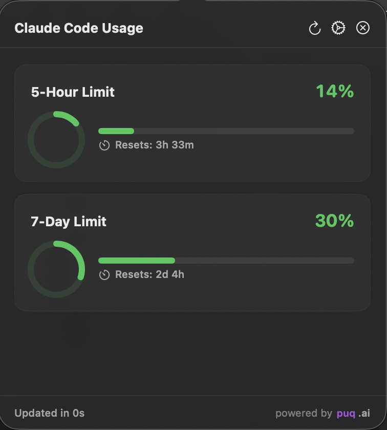
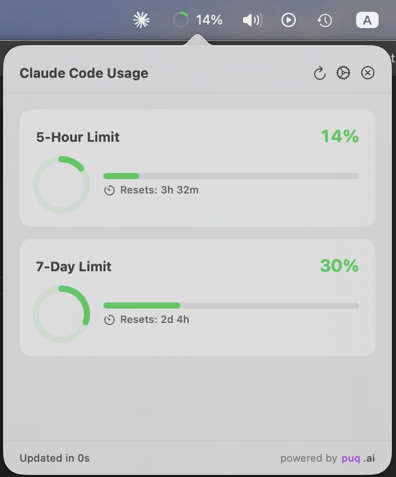

# ClaudeMeter

A macOS menu bar utility that shows your Claude usage limits — the 5-hour session, the 7-day window, and per-model limits — at a glance, with alerts before you hit them.

<p align="center">
  
  
</p>

## Features

- **Every limit the server reports**: 5-hour and 7-day windows plus per-model weekly limits, each with its reset countdown
- **Menu bar widget**: Current 5-hour usage (7-day on plans without a 5-hour window) as a ring, ring + percentage, or `5h | 7d` text
- **Usage breakdown**: What is consuming your 7-day limit (Claude Code, chats, Cowork), and extra usage spend
- **Notifications**: Alerts at 75%, 90% and 95% per limit, plus a notice when a limit resets
- **claude.ai fallback**: Sign in to claude.ai inside the app (or paste a session key) and usage keeps updating when the Claude Code API is rate limited or unavailable — or when you don't use the CLI at all
- **Smart polling**: Polls faster as a limit gets close, refreshes right after a reset, honours rate limits, and recovers after sleep or going offline
- **Offline caching**: Shows the last known usage when nothing can be fetched
- **Native macOS**: SwiftUI, no Electron, credentials stay in your Keychain

## Requirements

- macOS 14.0 (Sonoma) or later
- Xcode 15.0+ (for building from source)
- Claude Code CLI authenticated (`claude auth login`)

## Installation

### Download Release

1. Download `ClaudeMeter-<version>.dmg` from the [Releases](https://github.com/puq-ai/claude-meter/releases) page
2. Open the DMG and drag `ClaudeMeter.app` to Applications
3. Launch the app; it appears in the menu bar

### Build from Source

```bash
# Clone the repository
git clone https://github.com/puq-ai/claude-meter.git
cd claude-meter

# Build the app
xcodebuild -scheme ClaudeMeter -configuration Release build

# Or open in Xcode
open ClaudeMeter.xcodeproj
```

To build a release DMG: `./scripts/create-dmg.sh 1.3.0`

## Configuration

ClaudeMeter reads the credentials the Claude Code CLI stores in your Keychain. Sign in once:

```bash
claude auth login
```

ClaudeMeter picks the session up automatically — no restart needed. With no CLI credentials, the popover offers both options: **Sign in with claude.ai** or **Use the Claude Code CLI**.

### claude.ai Fallback

Optional. In **Settings → General → claude.ai Fallback**, choose **Sign In…** to sign in to claude.ai in an app window. The session is stored in your Keychain and used whenever the Claude Code API can't be reached.

If the in-app sign-in doesn't work (passkeys and some identity providers refuse embedded web views), sign in to claude.ai in your browser, copy the `sessionKey` cookie, and paste it under **Enter a session key manually**. The organization is found for you.

### Settings

Open settings with the gear icon in the popover:

- **General**: Launch at login, model limits / usage breakdown / extra usage visibility, Dock icon, refresh interval (30 s – 5 min), claude.ai fallback
- **Appearance**: Menu bar display (Icon Only / Compact / Detailed), color scheme (Auto / Light / Dark)
- **Notifications**: Enable alerts, choose the 75% / 90% / 95% thresholds
- **About**: Version information

## Architecture

```
ClaudeMeter/
├── App/                         # App entry point, AppDelegate, AppState
├── Core/
│   ├── Constants.swift          # Centralized configuration
│   ├── Protocols/               # Service abstractions
│   ├── Models/                  # Data models
│   ├── Services/                # API, Keychain, Notifications
│   └── Managers/                # Usage, polling, cache
├── UI/
│   ├── Auth/                    # Connect screen, claude.ai sign-in
│   ├── MenuBar/                 # Status bar item
│   ├── Popover/                 # Main UI views
│   ├── Settings/                # Settings views
│   └── Components/              # Reusable components
└── Extensions/                  # Swift extensions
```

### Key Components

- **APIService**: Claude Code usage API and the claude.ai fallback, with retry on server and network errors
- **KeychainService**: Reads the Claude Code CLI credentials; stores the claude.ai session
- **UsageManager**: Fetches usage, falls back to claude.ai or the cache, and tracks auth state
- **PollingManager**: Adaptive polling, rate-limit cooldown, circuit breaker, sleep/wake and network recovery
- **NotificationService**: Threshold and limit-reset alerts, deduplicated per limit
- **CacheManager**: Offline caching of usage data

## Contributing

Contributions are welcome! Please read [CONTRIBUTING.md](CONTRIBUTING.md) for guidelines.

## License

This project is licensed under the MIT License - see the [LICENSE](LICENSE) file for details.

## Acknowledgments

- Built for use with [Claude Code](https://claude.ai/claude-code)
- Powered by the Anthropic API

---

**Developed by ali@[puq.ai](https://puq.ai)**
